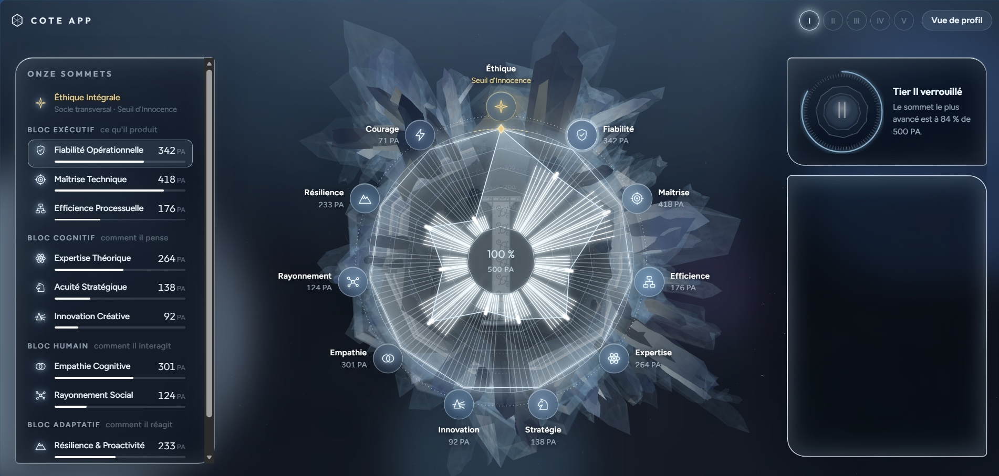
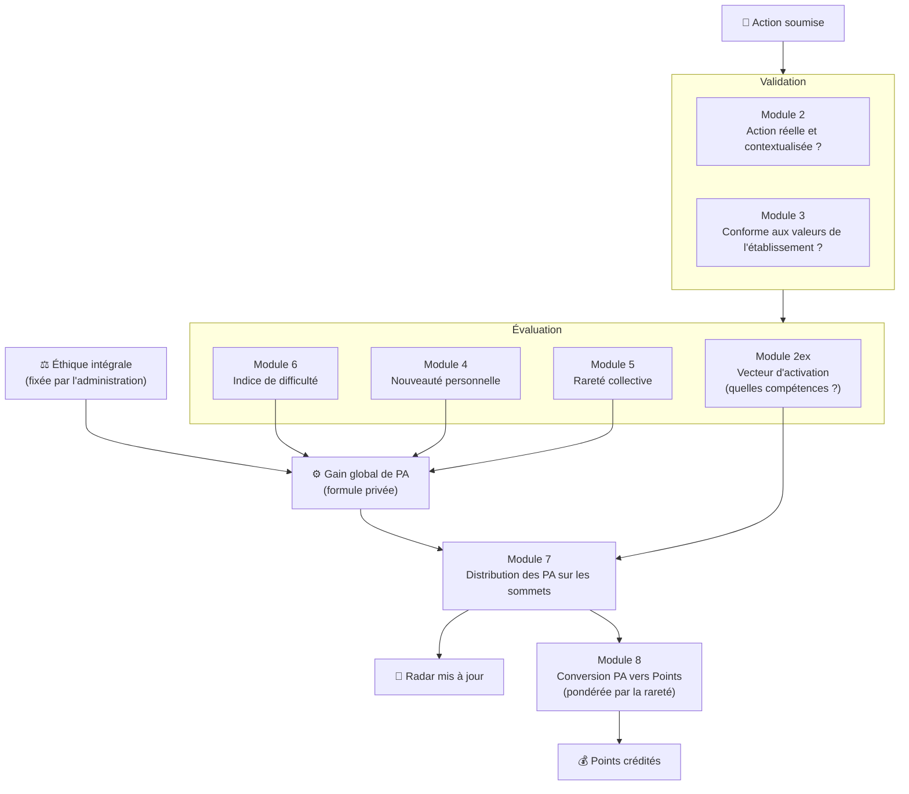
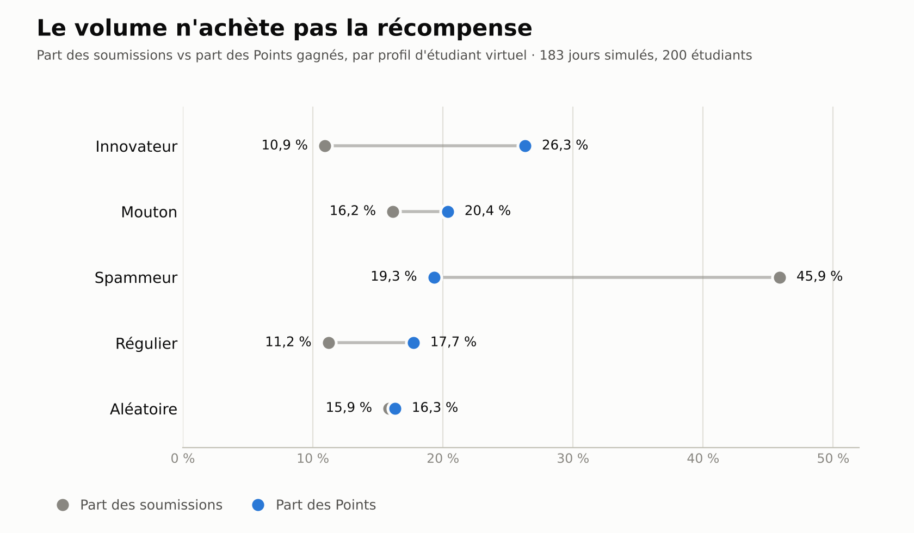
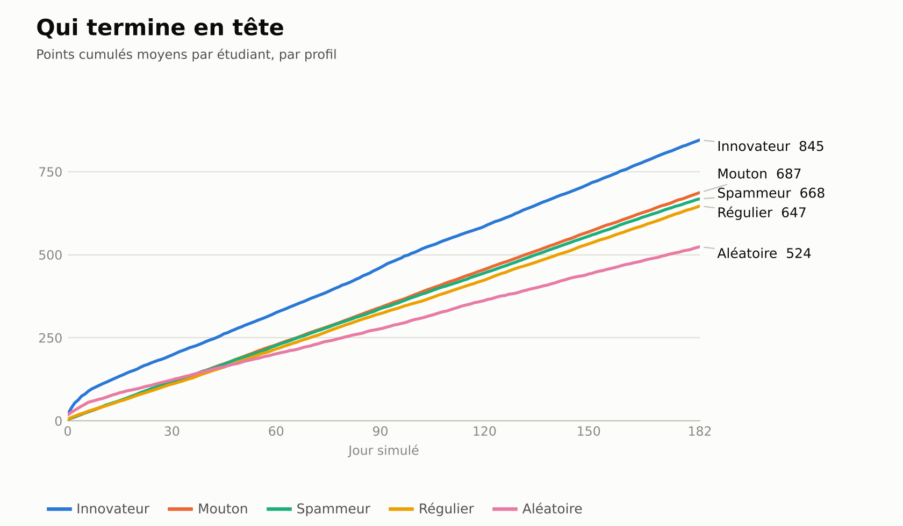
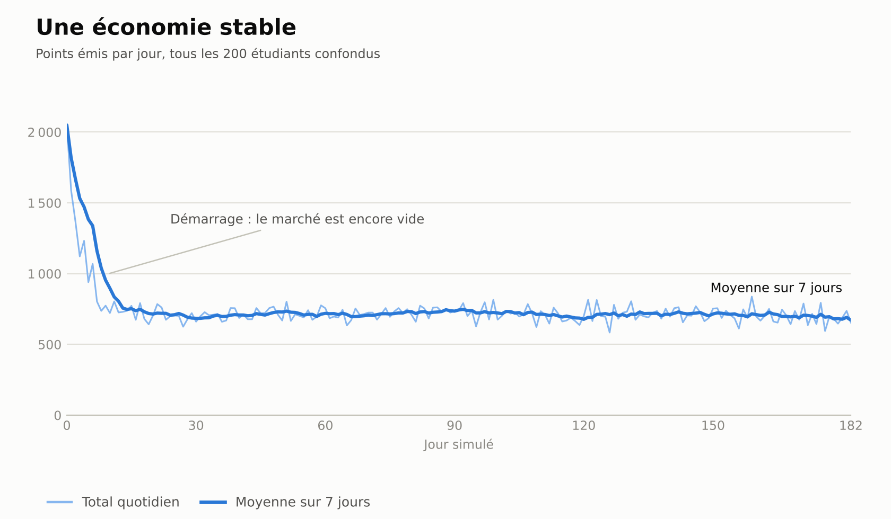

<div align="center">

# 🎓 COTE App

### Système de gamification éducative et d'ingénierie comportementale

*Chaque jour sur le campus est une aventure. Chaque aventure laisse une trace dans vos compétences.*


[English](README.md) · **Français**

[Vision](#-vision-et-problématique) ·
[Le radar](#-le-radar-psychométrique-à-11-axes) ·
[Le moteur](#-de-laction-au-chiffre--le-moteur-dévaluation) ·
[État du backend](#-backend--où-en-sont-les-choses) ·
[Simulation](#-le-bac-à-sable-de-simulation) ·
[Défis](#-le-point-dur--apprendre-aux-machines-à-comprendre-le-contexte) ·
[Feuille de route](#-démarches-envisagées-pour-la-suite)

</div>

---

> **Statut du dépôt : code fermé / documentation publique**
>
> *En raison de la nature propriétaire des algorithmes psychométriques, des modèles de validation sémantique (NLP) et des équations de notation dynamique, le code source du cœur du projet est conservé dans un dépôt privé. Ce dépôt public fait office de livre blanc technique : il présente l'architecture du système, le flux de données et les mécaniques comportementales.*

## Le projet en 30 secondes

**COTE transforme la vie de campus en une aventure vivante et mesurable.**

Les étudiants affrontent des défis, des rencontres, des tests pratiques et des projets imprévisibles. Un moteur d'IA lit ce qu'ils ont *réellement fait* (et non ce qu'ils prétendent) et en tire trois choses :

- un **radar de compétences vivant à 11 axes** qui montre qui ils deviennent,
- une **monnaie, les Points**, qui récompense les réalisations réelles, variées et difficiles (et rend inutile le fait de répéter la même action facile),
- un **portrait fiable** de leurs soft skills, consultable par eux et par les tiers qu'ils autorisent.

**Un premier résultat de simulation :** lors d'un test de résistance avec 200 étudiants virtuels, le profil qui inonde le système d'actions a généré **46 % de toutes les soumissions mais n'a récolté que 19 % des Points**, tandis que les innovateurs, avec 11 % des soumissions, en ont récolté **26 %**. [Voir les résultats](#-le-bac-à-sable-de-simulation).

> 🧭 **Où en est le projet aujourd'hui :** COTE est dans sa **phase backend**. Le moteur d'évaluation, le pipeline du diagnostic d'entrée et le simulateur d'économie existent et fonctionnent. Tout ce qui relève de la couche applicative (événements, application mobile/bureau, marketplace, portail entreprise…) est décrit dans ce document comme une **démarche envisagée pour la suite** et est signalé comme tel.

---

## Vision et problématique

Les systèmes académiques traditionnels souffrent d'une grave **« asymétrie d'information »** : entre deux sessions d'examens, les établissements sont aveugles aux soft skills réelles, à l'engagement social et au leadership d'un étudiant. Le diplôme certifie les hard skills, mais le monde moderne exige un **« Certificat de Savoir-Être »**.

**COTE App** est un écosystème gamifié d'une grande complexité conçu pour y répondre. Inspiré de la psychologie comportementale et de la théorie des jeux, le système transforme le campus en un environnement dynamique où chaque jour est une aventure imprévisible. Il récompense les actions concrètes, la collaboration entre pairs et la résilience, et convertit des comportements humains abstraits en données quantifiables et certifiées.

### Cinq angles morts que COTE s'attaque à combler

| Le problème | Ce qu'apporte COTE |
|---|---|
| **Le « trou noir » extrascolaire.** Entre deux sessions d'examens, l'école est aveugle : elle ne voit ni ses leaders naturels, ni ses étudiants isolés, ni ses talents cachés avant qu'il ne soit trop tard. | Une vision en temps réel de l'engagement réel de la masse étudiante. |
| **Le diplôme ne suffit plus.** Les recruteurs exigent des preuves de fiabilité, de communication et de résilience qu'un GPA ne peut pas fournir. | Un *Certificat de Savoir-Être* appuyé sur des années de comportements observés. |
| **La passivité.** Beaucoup d'étudiants font le minimum, et un campus « mort » nuit à l'attractivité de l'école. | Une pression sociale positive : statut et privilèges suivent l'activité réelle. |
| **Réputation et conduite.** Un établissement a peu de leviers hors des murs de la classe. | Un axe d'intégrité transparent : la conduite a des conséquences visibles et proportionnées. |
| **Une identité alumni faible.** Les diplômés qui n'ont été qu'un numéro de matricule ressentent peu d'appartenance. | Un historique de réalisations qui donne à chaque étudiant, et à chaque promotion, une identité forte. |

### L'idée centrale : le chaos constructif

La vie de campus a tendance à s'installer dans la routine : mêmes salles, mêmes visages, mêmes attentes. Cette monotonie gâche discrètement le plaisir d'explorer et d'apprendre, et pousse les esprits ambitieux à se replier sur eux-mêmes.

La réponse de COTE est d'injecter de l'**imprévisible**, volontairement et avec des règles :

- des **défis surprises** hors du cadre habituel du cursus
- des **rencontres inattendues**, avec des équipes et des binômes qui traversent les départements
- des **tests pratiques** où les étudiants montrent ce dont ils sont réellement capables
- des **projets aléatoires mais pleinement valides**, dont certains pour de vraies organisations extérieures à l'école

Comme les situations sont imprévisibles, l'évaluation peut être **multidisciplinaire** : non pas un examen qui mesure une compétence, mais de nombreuses situations différentes qui révèlent de nombreuses facettes d'une personne. Tout ce que l'étudiant réalise est converti en statistiques et en avantages que lui-même, et les tiers autorisés, peuvent consulter depuis l'interface du système, qui l'encourage sans cesse à développer chacune de ses aptitudes.

---

## Le radar psychométrique à 11 axes

Le cœur du profil de chaque étudiant est un graphique radar dynamique généré par la **« Skill Mapping IA »**. Son état initial (Phase 1) est calibré par un test psychométrique d'entrée basé sur le modèle **OCEAN**. Ensuite, le radar n'évolue que d'une seule façon : par **ce que l'étudiant fait**.

Les 11 vecteurs sont regroupés en quatre blocs plus un filtre transversal. Chaque axe existe pour répondre à une question précise :

| Bloc | Axe | La question à laquelle il répond |
|---|---|---|
| **Exécutif**<br/>*ce qu'il produit* | Fiabilité opérationnelle | *Peut-on lui confier une tâche les yeux fermés ?* |
| | Maîtrise technique | *Sait-il faire, concrètement et correctement ?* |
| | Efficience processuelle | *Sait-il faire mieux avec ce qu'il a déjà ?* |
| **Cognitif**<br/>*comment il pense* | Expertise théorique | *A-t-il les fondations pour comprendre et apprendre vite ?* |
| | Acuité stratégique | *Comprend-il le tableau d'ensemble ?* |
| | Innovation créative | *Sait-il inventer une solution quand il n'en existe pas ?* |
| **Humain**<br/>*comment il interagit* | Empathie cognitive | *Comprend-il vraiment les gens qui l'entourent ?* |
| | Rayonnement social | *Sait-il mobiliser et convaincre ?* |
| **Adaptatif**<br/>*comment il réagit* | Résilience & proactivité | *Tient-il debout sous pression, et agit-il sans qu'on le lui demande ?* |
| | Courage décisionnel | *Ose-t-il décider et assumer quand c'est difficile ?* |
| **Le Filtre**<br/>*12 heures* | **Éthique intégrale** | *Peut-on lui faire confiance quand personne ne regarde ?* |

### ⚖️ Le filtre de 12 heures : l'Éthique intégrale

L'Éthique intégrale occupe le haut du radar, le « nord magnétique » du profil, et fonctionne différemment de tous les autres axes :

- Elle est **passive**. Aucune action déclarée par l'étudiant ne peut la faire monter automatiquement.
- Elle part d'un **seuil de confiance** identique pour tous : la présomption d'innocence.
- Elle n'est modifiée que par **l'administration**, via la modération (sanctions pour triche ou plagiat, bonus pour comportement exemplaire).
- Elle agit comme un **multiplicateur global**. Un score élevé amplifie tous les autres gains de compétences ; une pénalité ralentit toute la progression. L'intégrité n'est pas une compétence parmi d'autres : c'est le filtre à travers lequel toutes les autres prennent leur sens.

Un recruteur qui ouvrirait un profil verrait d'abord ce sommet, avant tout bloc technique. C'est voulu.

### Aspect visuel actuel

<div align="center">

<!-- 👉 Déposez votre capture dans docs/images/radar-preview.jpg (ou changez le chemin ci-dessous) -->


*Le radar tel qu'il apparaît aujourd'hui dans le prototype.*

</div>

### Comment lire le radar

- **« Vos actions parlent pour vous. »** Le radar est nourri par l'évaluation objective de vos actes par le système, jamais par l'auto-évaluation.
- **« La forme compte autant que la taille. »** L'équilibre du profil compte : des sommets forts compensent des lacunes ailleurs.
- **« Repoussez vos limites. »** L'échelle du radar est faite de **Tiers** successifs. Quand vous touchez le bord, il est temps de briser le plafond et de débloquer le niveau supérieur. Le changement est irréversible, et la distance jusqu'au Tier suivant grandit pour que les derniers ne soient jamais atteints trop vite.

---

## De l'action au chiffre : le moteur d'évaluation

Comment noter équitablement « j'ai organisé un hackathon caritatif » et « j'ai aidé un camarade », sur la même échelle, pour des centaines d'étudiants, sans que le système soit détourné ? COTE fusionne deux idées dans un **modèle hybride** :

- une approche **individuelle** basée sur la **similarité sémantique** (*tournez-vous en rond ou vous diversifiez-vous ?*)
- une approche **collective**, de type marché, basée sur la **rareté** (*à quel point ce type d'action est-il saturé dans toute la promotion ?*)

Quand une action est validée, son gain global de Points d'Attribut (**PA**) est fonction de cinq moteurs :

```text
Gain_PA = f( I_diff, PA_max, PA_ethique, C_perso, C_global )
```

| Moteur | Signification |
|---|---|
| `PA_max` | Le maximum théorique qu'une action *parfaite* peut rapporter. |
| `I_diff` | **Indice de difficulté.** Les réalisations difficiles valent bien plus que les simples, qui peuvent ne presque rien valoir. |
| `PA_ethique` | Le niveau d'**Éthique intégrale** de l'étudiant, qui agit comme multiplicateur. |
| `C_perso` | **Modulateur personnel.** Compare l'action à l'historique de l'étudiant, avec une décroissance dans le temps : se répéter tout de suite coûte plus cher que revenir à une activité quelques semaines plus tard. |
| `C_global` | **Modulateur collectif (« la bourse »).** Mesure la popularité d'une action au sein de toute la promotion. Une action saturée rapporte moins, une action rare rapporte plus. |

Les deux modulateurs se combinent : celui qui s'acharne sur une seule activité est pénalisé deux fois, une fois pour avoir saturé le marché et une fois pour s'être répété. C'est ce qui rend le farming individuel non rentable et contient l'inflation globale.

> 🔒 La formule exacte, les coefficients, les seuils et la calibration font partie du cœur privé.

### Répartir le gain sur le radar

Une action sollicite rarement une seule compétence. Pour chaque sommet du radar, un **vecteur d'activation** attribue un score entre `0.0` et `1.0` indiquant à quel point cette compétence est impliquée. Le gain global est ensuite **distribué** sur les sommets selon cette influence, avec un frein naturel sur les compétences déjà maîtrisées. Le radar se remplit donc de façon *asymétrique*, à l'image de ce qui a réellement été fait.

Si une action est si courte ou floue (« j'ai aidé ») qu'aucun sommet ne s'active, le moteur déclare un **échec d'activation** : aucun calcul, aucun Point, et un message spécifique renvoyé à l'utilisateur.

### Des PA aux Points

Une fois le radar mis à jour, les PA gagnés sur chaque sommet sont convertis en **Points**, la monnaie du système. Chaque sommet appartient à une catégorie avec son propre **multiplicateur de rareté**, afin que les compétences plus rares et plus difficiles à développer soient récompensées en conséquence.

### Le pipeline complet



---

## Backend : où en sont les choses

COTE est actuellement dans sa **phase backend**, construite comme une chaîne de modules indépendants. Voici un état des lieux honnête.

| Module | Rôle | Statut |
|---|---|---|
| **2** · Validation de l'action | Un modèle sémantique vérifie que le texte décrit réellement quelque chose que la personne a *fait*, avec au moins quelques détails de contexte. Il détermine si une action peut recevoir des PA et générer des Points. | 🔴 Début, nécessite encore beaucoup de développement |
| **2ex** · Vecteur d'activation | Un LLM note chaque sommet du radar de 0.0 à 1.0 selon l'implication de cette compétence dans l'action. | 🟡 Encourageant, précision encore limitée |
| **3** · Conformité aux valeurs | Compare l'action à un dictionnaire d'actions incarnant les valeurs de l'établissement, pour repérer les actions non conformes (une action immorale, par exemple). | 🟠 Prototype fonctionnel |
| **4** · `C_perso` | Compare une nouvelle action à l'historique de l'étudiant, avec une décroissance dans le temps de la pénalité. Utilise un sentence-transformer multilingue (famille MiniLM), le modèle qui a offert la meilleure résolution de similarité lors des tests, même face à des modèles plus lourds. | 🟡 Fonctionnel, limité par le moteur sémantique |
| **5** · `C_global` | Même moteur sémantique, appliqué aux actions de toute la communauté. | 🟡 Fonctionnel, limité par le moteur sémantique |
| **6** · `I_diff` | Un LLM note l'action selon un ensemble de règles pour produire l'indice de difficulté. | 🟡 Encourageant, précision encore limitée |
| **7** · Distribution | Reçoit le vecteur d'activation et le gain global de PA, puis répartit les PA sur les sommets activés selon leur influence. | ✅ Fait exactement son travail |
| **8** · Conversion en Points | Convertit les PA gagnés par sommet en Points, grâce aux multiplicateurs de rareté des sommets. | ✅ Fait exactement son travail |
| **10** · Diagnostic de Phase 1 | Exécute tout le pipeline du test d'entrée, des questions au radar initial (voir ci-dessous). | ✅ Produit les résultats voulus |
| **Initialisation de la BDD de simulation** | Génère les tables de simulation, les étudiants virtuels, leurs radars et le pool d'actions. | ✅ Fonctionne comme voulu |
| **Simulateur d'économie** | Fait tourner l'économie sur des jours simulés (voir ci-dessous). | ✅ Jusqu'à une année complète |

<sub>✅ fonctionne comme prévu quand on lui fournit les bons éléments · 🟡 fonctionne, précision bornée par les modèles actuellement accessibles · 🟠 prototype · 🔴 stade initial</sub>

### Phase 1 : le test de diagnostic (Module 10)

Le premier calibrage d'un radar est un test d'entrée qui ressemble à un simple questionnaire mais a des allures d'examen : idéalement passé dans l'établissement sous surveillance, l'administration choisissant étudiant par étudiant qui peut le passer. L'interrompre ou quitter l'application l'annule.

> *« **Ceci n'est pas un examen, mais une cartographie de vos réflexes.** L'algorithme est conçu pour repérer et pénaliser les tentatives de créer un « profil idéal » ou incohérent. Jouez le jeu : soyez vous-même.*
> ***Chaque choix implique un renoncement.** Il n'y a pas de parcours parfait. Un score élevé en audace diminuera mécaniquement votre score en prudence. C'est attendu et valorisé.*
> ***Votre spontanéité compte.** Ne sur-analysez pas. Certaines étapes sont des points de non-retour.*
> *Lisez. Choisissez. Avancez. »*

Ce qui se passe sous le capot :

- **Pas juste ou faux, mais un signal.** Le test ne note pas des réponses (hors pièges d'attention) : il mesure l'*intensité d'un signal comportemental*, ainsi que *la façon* dont l'étudiant interagit avec l'interface, en s'appuyant sur la théorie des Systèmes 1 et 2 de Daniel Kahneman.
- **Un test différent pour chacun.** Les questions et leur ordre sont tirés au hasard pour chaque étudiant. Les questions les plus stratégiques demandent une réponse libre.
- **Un tenseur à 13 cellules.** Les résultats alimentent un vecteur de 13 variables notées de 0 à 100, organisées selon quatre axes : traits de personnalité stables (OCEAN), traitement cognitif (*comment navigue-t-il vers ses objectifs ?*), motivations et valeurs (*vers quoi tend-il ?*) et métadonnées comportementales. L'étudiant ne voit que les cinq premières cellules, ses scores OCEAN, pour lui rappeler qui il est. Le moteur exploite le tenseur entier.
- **Sept sommets « soft skills » sont initialisés :** Fiabilité opérationnelle, Acuité stratégique, Innovation créative, Empathie cognitive, Rayonnement social, Résilience & proactivité et Courage décisionnel. Les sommets « hard skills » (Maîtrise technique, Efficience processuelle, Expertise théorique) dépendent trop de comportements observables pour être initialisés ici ; ils sont traités dans une phase ultérieure (voir la feuille de route).
- **Conçu de A à Z en interne.** La base de questions a été élaborée à partir de recherches sur les modèles psychologiques et les tests de personnalité existants. L'unique « question signature » à réponse libre est évaluée par un LLM qui suit un barème détaillé ; tout le reste est géré par le code.

🔒 La matrice de pondération et la formule de projection font partie du cœur privé.

---

## Le bac à sable de simulation

Pour convaincre n'importe quel établissement, l'économie doit *prouver* qu'elle tient la route. Le prototype inclut donc un **bac à sable** : un simulateur qui génère des « étudiants virtuels » et fait défiler des mois de vie de campus en quelques secondes, comme test de résistance de tout le système. Le moteur a tourné jusqu'à **une année complète (365 jours simulés)**, sur plusieurs exécutions, avec des tours de rééquilibrage successifs et l'optimisation en performance de chaque étape. La dernière exécution documentée couvre **183 jours** (environ un semestre).

### De quoi il est fait

- **Des agents virtuels avec des profils comportementaux :** *spammeur*, *innovateur*, *mouton*, *régulier* et *aléatoire*, chacun avec son radar.
- **Un pool de 3 500 actions** où piocher : des actions *routine* du quotidien, des actions *sociales* et des actions d'*innovation*, plus **200 « pièges » volontaires** qu'un système sain doit refuser : des comportements *anti-valeurs* (sabotage, manipulation), des affirmations *irréalistes* et des absurdités *rejetées en bloc*.
- **Une base de données** (PostgreSQL + pgvector) à cinq tables : profils des agents, radars, pool d'actions, historique des soumissions (qui conserve les coefficients exacts appliqués à l'époque) et registre des Points.
- **Un moteur rapide** qui appelle les Modules 4, 5, 7 et 8, optimisés pour la vitesse (multiplication matricielle plutôt que calculs itératifs).

| Un exemple du pool | Type |
|---|---|
| *« J'ai mis à jour le tableau Excel sans utiliser d'aide externe. »* | Routine |
| *« J'ai modéré une session de tutorat qui a remotivé l'équipe. »* | Sociale |
| *« J'ai optimisé un système de cache intelligent qui a remporté le premier prix. »* | Innovation |
| *« J'ai saboté un élève en difficulté par pur égoïsme. »* | Piège : anti-valeurs |
| *« J'ai résolu toutes les maladies rares pendant ma pause de 15 minutes. »* | Piège : irréaliste |
| *« J'ai détruit le campus d'une école concurrente avec un rayon laser géant. »* | Piège : rejeté en bloc |

### La dernière exécution en un coup d'œil

| Étudiants virtuels | Actions dans le pool | Jours simulés | Soumissions | Transactions de Points |
|:---:|:---:|:---:|:---:|:---:|
| **200** | **3 500** | **183** | **85 062** | **52 311** |

### Ce que montre la simulation

**1. Les pièges ne rapportent rien.** Les 200 actions-pièges ont été soumises **32 751 fois, soit 38,5 % de tout le trafic**, et aucune n'a produit le moindre PA.

**2. Inonder le système ne paie pas.** Les spammeurs envoient 5,5 soumissions par étudiant et par jour, contre 1,2 pour les innovateurs. Ils génèrent **46 % de toutes les soumissions** mais ne récoltent que **19 % de tous les Points**, alors que les innovateurs envoient 11 % du trafic et gagnent **26 %** des Points. (Les deux tiers du trafic d'un spammeur sont des pièges ; le reste est de la routine.)

<p align="center">
<picture>
  <source media="(prefers-color-scheme: dark)" srcset="docs/images/simulation/volume-vs-points.fr.dark.png">
  
</picture>
</p>

**3. Se répéter fait à peine bouger le radar.** En prenant comme référence (100) la progression de radar qu'un innovateur gagne par action *valide*, un étudiant régulier qui mélange routine et actions sociales atteint 14, tandis que les moutons et les spammeurs qui répètent des actions de routine atteignent environ 4 : une progression environ **25 fois plus faible** pour le même nombre d'actions valides.

| Profil | Innovateur | Aléatoire | Régulier | Mouton | Spammeur |
|---|:---:|:---:|:---:|:---:|:---:|
| **Progression du radar par action valide** (innovateur = 100) | 100 | 81 | 14 | 4 | 4 |

**4. Les innovateurs finissent en tête.** Sur l'ensemble de l'exécution, les innovateurs terminent avec environ 845 Points en moyenne, contre 647 à 687 pour les profils mouton, spammeur et régulier, et 524 pour le comportement aléatoire.

<p align="center">
<picture>
  <source media="(prefers-color-scheme: dark)" srcset="docs/images/simulation/points-over-time.fr.dark.png">
  
</picture>
</p>

**5. Une économie stable.** Après un démarrage où le marché est encore vide et où les bonus de rareté sont à leur maximum, l'émission quotidienne de Points reste plate (variation d'un jour à l'autre d'environ 6,5 %) pendant les cinq mois suivants : pas d'inflation incontrôlée dans cette exécution.

<p align="center">
<picture>
  <source media="(prefers-color-scheme: dark)" srcset="docs/images/simulation/economy-stability.fr.dark.png">
  
</picture>
</p>

### Ce que cette exécution ne prouve *pas* (encore)

- Les actions sont **synthétiques et issues de modèles de phrases**, pas de vraies soumissions d'étudiants.
- Les verdicts des Modules 2 et 3 sont **pré-enregistrés sur chaque action** du pool : l'exécution teste donc l'*économie* du moteur, pas la détection sémantique elle-même.
- Les profils d'agents sont des **archétypes figés** : les étudiants virtuels n'adaptent pas leur comportement à ce que le système récompense.
- Le pool ne sollicite pas encore trois sommets du radar (Acuité stratégique, Résilience & proactivité, Courage décisionnel), qui ne bougent donc pas dans cette exécution.
- **Le rééquilibrage est en cours.** Il s'agit d'un instantané de prototype, pas d'une calibration définitive.

### Données ouvertes

Les résultats agrégés, un échantillon du pool d'actions et un dictionnaire de données sont disponibles dans [`simulation/`](simulation/). Les logs ligne par ligne restent dans le dépôt privé.

---

## 🚧 Le point dur : apprendre aux machines à comprendre le contexte

COTE est développé en solo, avec un budget nul, à partir de modèles locaux gratuits et d'offres d'API gratuites. Cela a donné des leçons utiles et définit la frontière actuelle du projet.

**1. La similarité sémantique (Modules 3, 4, 5).** Le meilleur modèle gratuit testé reste dépendant des mots-clés. Deux actions qui signifient des choses complètement différentes peuvent paraître proches, tandis que deux actions décrivant la même chose avec des mots différents peuvent paraître sans rapport. Des seuils de confiance donnent le meilleur compromis trouvé à ce jour : c'est encourageant, mais loin d'être « suffisant ».

**2. Le jugement par LLM (Modules 2ex, 6 et la question signature de la Phase 1).** Faire tourner un modèle en local (Llama 3 via Ollama) est trop lent pour itérer : dix minutes ou plus pour un seul vecteur d'activation. Les offres gratuites hébergées règlent la vitesse mais imposent des limites d'usage. Les résultats sont encourageants mais n'ont pas la précision chirurgicale d'un modèle de pointe.

💡 Un constat se détache : **plus le travail du LLM ressemble à « suivre ce barème détaillé », mieux il le réussit.** La question signature de la Phase 1, évaluée selon un barème précis, fonctionne très bien. C'est dans les jugements ouverts que les limites apparaissent.

**Ce qui débloquerait le palier suivant :** l'accès à des modèles de langage et sémantiques plus capables pour l'évaluation.

---

## Principes directeurs

Le système suit beaucoup de choses : il doit donc être digne de confiance. Ces principes font partie de sa conception :

- **Les Points sont privés.** Le solde d'un étudiant n'est connu que de lui, avec deux exceptions étroites : une demande officielle de divulgation de l'administration, et un Privilège précis.
- **Les Points gagnés ne sont jamais confisqués.** Aucun prélèvement automatique ni pénalité sur les Points : ce qui est gagné est gagné.
- **Présomption d'innocence.** Chacun part d'un seuil de confiance sur l'axe Éthique ; seule l'administration peut le faire bouger.
- **La preuve reste dans le système.** Les vidéos prises dans l'application servent uniquement à la validation, et ne sont ni partagées ni utilisées autrement.
- **Profils fantômes (Shadow Profiles).** Avant d'accepter un contrat de tutorat, on ne voit qu'une vue à visibilité limitée des tendances du demandeur (progression, assiduité, points forts et faibles), sans son identité complète ni ses données privées.
- **Requêtes entreprises anonymisées.** Les partenaires filtrent une base de données anonymisée.
- **Transparence.** Les étudiants doivent pouvoir comprendre pourquoi une action a rapporté ce qu'elle a rapporté.

---

## Démarches envisagées pour la suite

Tout ce qui suit est **envisagé**, pas encore construit. Le backend passe en premier.

**🎯 Évaluation et calibrage**
- [ ] **Phase 1.2 : tests logiques** (jeux, problèmes, exercices) pour initialiser les sommets « hard skills »
- [ ] **Phase 2 : stress-test de terrain** (4 à 6 semaines) pour observer les premiers comportements une fois l'« effet lune de miel » dissipé ; l'établissement orchestre la pression, COTE observe
- [ ] **Phase 3 : inertie de croissance** avec une moyenne mobile exponentielle : plus l'historique est long, plus le profil est lourd à faire bouger
- [ ] **Notation relative dynamique** basée sur les quartiles de la promotion et l'écart-type, avec détection d'anomalies (chute d'activité soudaine, triche potentielle) et retour direct aux enseignants sur leurs méthodes

**📝 Actions et preuves**
- [ ] **Module de Preuve d'Action** pour déclarer ou programmer des activités, internes ou externes, avec des détails obligatoires et une preuve numérique ; certaines nécessitent la validation d'un administrateur ou d'un partenaire certifié
- [ ] **Vault Camera** : courtes vidéos horodatées dans l'application, seule preuve vidéo recevable
- [ ] **Débriefing (« Feedback »)** : une courte conversation ciblée, déclenchée au hasard ou par l'utilisateur
- [ ] Un **catalogue d'actions** consultable, proposées par des étudiants, des enseignants et des profils vérifiés

**🎲 Rencontres et imprévisibilité**
- [ ] **Projets aléatoires** : missions de courte durée qui recrutent des équipes inter-départements, certaines pour des entreprises locales
- [ ] **Shuffle Profiles** : un protocole de matching pour les contrats de tutorat et le 1-to-1, fondé sur la complémentarité
- [ ] **Système recommandeur / coaching psychologique** : micro-défis ciblés pour les profils enfermés dans leur zone de confort

**💰 L'économie des Points**
- [ ] **Marketplace de Privilèges**, points de vente partenaires acceptant les Points, récompenses de quêtes et cadeau de bienvenue
- [ ] **Transferts entre étudiants**, avec une barrière de frais entre niveaux pour que chaque nouvelle promotion prouve sa propre valeur plutôt que de vivre sur les acquis des aînés
- [ ] **Dotation mensuelle de classe** fondée sur l'assiduité collective, la progression moyenne du radar et l'harmonie sociale
- [ ] **Sinks de valeur** pour contenir l'accumulation sans confisquer
- [ ] **Indicateurs comportementaux**, comme un ratio de thésaurisation qui distingue les « fourmis » des « investisseurs »
- [ ] **Dashboard « boursier » des actions** montrant tendances et opportunités, avec une recherche pour connaître la valeur actuelle d'une action sans l'enregistrer

**🌍 Rayonnement**
- [ ] **Portfolio certifié** signé par l'établissement, exportable vers LinkedIn ou sous forme de lien sécurisé pour les recruteurs
- [ ] **Portail entreprise** avec des filtres complexes sur des données anonymisées
- [ ] **Application multiplateforme** (Flutter envisagé) avec les interfaces d'une plateforme scolaire pour étudiants, enseignants, administration et parents
- [ ] **Tutoriel d'initiation au radar**

---

## 🛠️ Stack technique

| Couche | Technologie |
|---|---|
| Backend | Python |
| Moteur sémantique | Sentence-Transformers, MiniLM multilingue (embeddings de dimension 384) |
| Données | PostgreSQL + pgvector |
| Couche LLM | Modulaire : local (Llama 3 via Ollama) ou API hébergée (Groq), choisie par un réglage |
| Simulation | Opérations matricielles vectorisées |
| Envisagé | Front-end multiplateforme (Flutter), couche API (FastAPI) |

---

## 📂 À propos de ce dépôt

Ce dépôt est la **vitrine publique** de COTE. Il est mis à jour progressivement pour refléter l'avancement réel du projet : schémas, captures, documentation et, quand c'est approprié, résultats anonymisés. Le code source de travail se trouve dans un dépôt privé.

```text
.
├── README.md          Version anglaise
├── README.fr.md       Version française (ce fichier)
├── docs/
│   └── images/        Capture du radar et graphiques de simulation
└── simulation/        Résultats agrégés et dictionnaire de données du bac à sable
```

## Me contacter

COTE est un projet ambitieux, pensé sur le long terme. Si le projet vous parle, que vous travailliez dans le **NLP et la similarité sémantique, l'évaluation par LLM, l'ed-tech, la gamification ou la psychométrie**, ou que vous dirigiez ou enseigniez dans un établissement qui pourrait en avoir l'usage, retours et idées sont les bienvenus. Ouvrez une issue ou lancez une discussion sur ce dépôt.

<!-- Ajoutez ici votre LinkedIn / e-mail si vous voulez qu'on puisse vous joindre directement. -->

---

<div align="center">

© 2026 COTE App. Tous droits réservés.
Les concepts, mécaniques et la documentation de ce dépôt sont partagés à titre informatif uniquement ; aucune licence de réutilisation n'est accordée.

</div>
