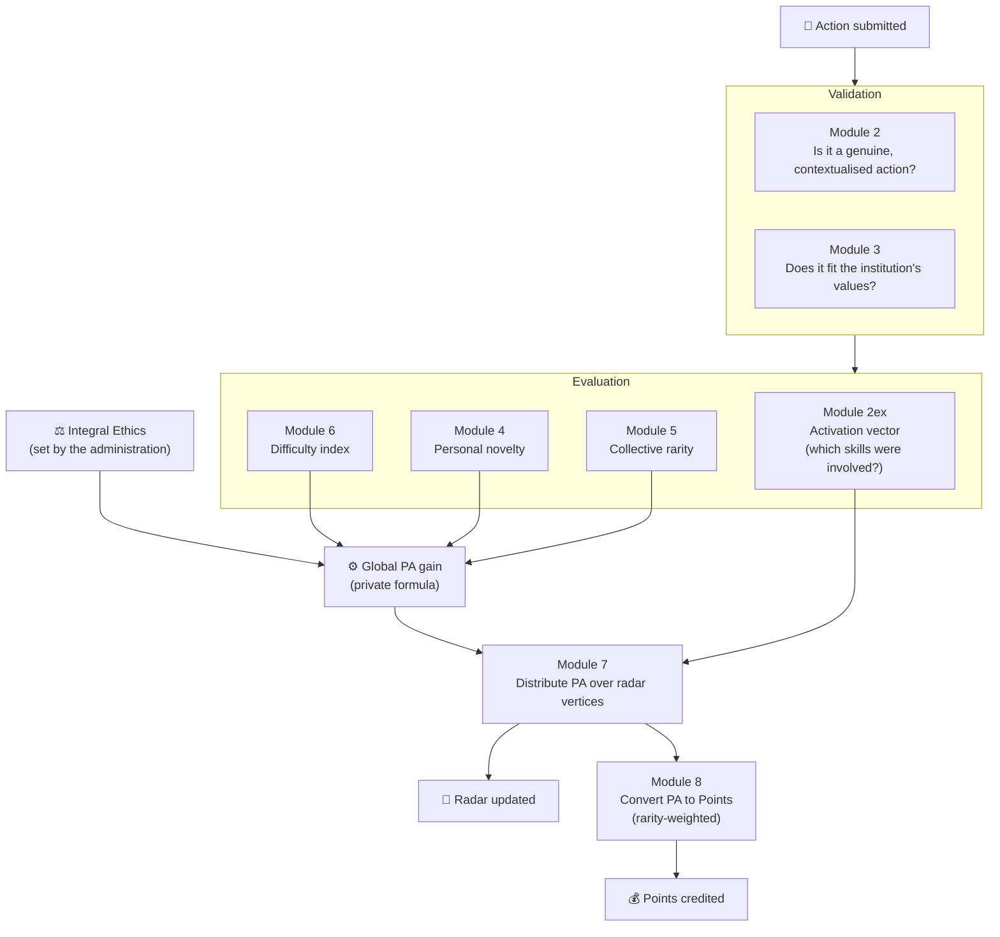
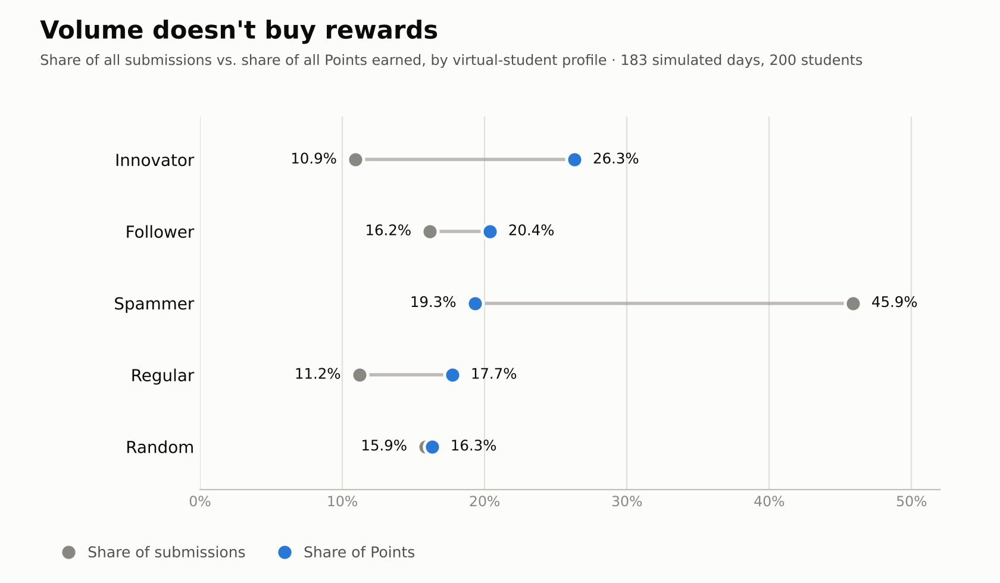
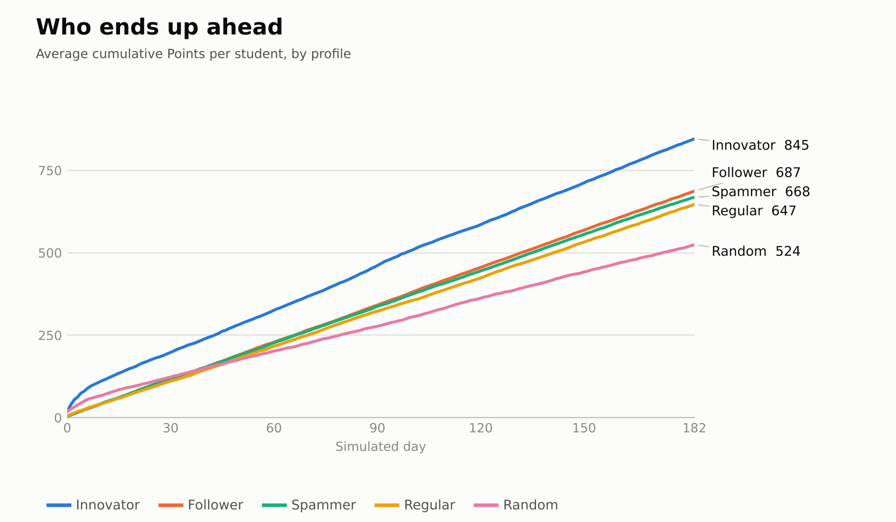
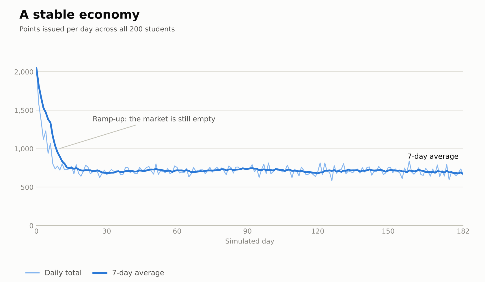

<div align="center">

# 🎓 COTE App

### Educational Gamification & Behavioral Engineering System

*Every day on campus is an adventure. Every adventure leaves a trace in your skills.*


**English** · [Français](README.fr.md)

[Vision](#-vision--problem-statement) ·
[The radar](#-the-11-axis-psychometric-radar) ·
[The engine](#-from-an-action-to-a-number-the-evaluation-engine) ·
[Backend status](#-backend-where-things-stand) ·
[Simulation](#-the-simulation-sandbox) ·
[Challenges](#-the-hard-part-teaching-machines-to-understand-context) ·
[Roadmap](#-envisioned-next-steps)

</div>

---

> **Repository Status: Closed Source / Public Documentation**
>
> *Due to the proprietary nature of the psychometric algorithms, the NLP semantic validation models, and the dynamic grading equations, the core source code of this project is maintained in a private repository. This public repository serves as a technical white paper showcasing the system's architecture, data flow, and behavioral mechanics.*

## The 30-Second Pitch

**COTE turns campus life into a living, measurable adventure.**

Students face unpredictable challenges, encounters, practical tests and projects. An AI engine reads what they *actually did* and turns it into three things:

- a **living 11-axis skill radar** that shows who they are becoming,
- a **currency of Points** that rewards real, varied, difficult achievements (and makes farming the same easy action pointless),
- a **trustworthy portrait** of their soft skills that they, and the third parties they authorise, can consult.

**A first simulation result:** in a stress test with 200 virtual students, the profile that floods the system with actions generated **46% of all submissions but collected only 19% of the Points**, while innovators, with 11% of the submissions, collected **26%**. [See the results](#-the-simulation-sandbox).

> 🧭 **Where things stand today:** COTE is in its **backend phase**. The evaluation engine, the onboarding diagnostic pipeline and the economy simulator exist and run. Everything that belongs to the application layer (events, mobile/desktop app, marketplace, employer portal…) is described in this document as an **envisioned next step** and is labelled as such.

---

## Vision & Problem Statement

Traditional academic systems suffer from severe **"Information Asymmetry"**: between exam sessions, institutions are blind to a student's actual soft skills, social engagement, and leadership. The diploma certifies hard skills, but the modern world demands a **"Certificate of Soft Skills"**.

**COTE App** is a highly complex gamified ecosystem designed to solve this. Inspired by behavioral psychology and game theory, the system transforms the campus into a dynamic environment where every day is an unpredictable adventure. It rewards real-world actions, peer-to-peer collaboration, and resilience, turning abstract human behaviors into quantifiable, certified data.

### Five blind spots COTE goes after

| The problem | What COTE brings |
|---|---|
| **The extracurricular "black hole".** Between two exam sessions, a school is blind. It cannot see its natural leaders, its isolated students or its hidden talents until it is too late. | A real-time picture of how engaged the student body really is. |
| **The diploma is not enough.** Recruiters ask for proof of reliability, communication and resilience that a GPA cannot give. | A *Certificate of Soft Skills* backed by years of observed behaviour. |
| **Passivity.** Many students do the bare minimum, and a "dead" campus hurts a school's attractiveness. | Positive social pressure: status and privileges follow genuine activity. |
| **Reputation and conduct.** An institution has little leverage outside classroom walls. | A transparent integrity axis, so conduct has visible, proportionate consequences. |
| **A weak alumni identity.** Graduates who were only a matriculation number feel little belonging. | A track record of achievements that gives each student, and each cohort, a strong identity. |

### The Core Idea: Constructive Chaos

Campus life tends to settle into a routine: same rooms, same faces, same expectations. That monotony quietly drains the pleasure of exploring and learning, and it makes ambitious people withdraw into themselves.

COTE's answer is to inject **unpredictability** — on purpose, and with rules:

- **Surprise challenges** that sit outside the usual curriculum
- **Unexpected encounters**, with teams and pairings that cross departments
- **Practical tests** where students show what they can really do
- **Random but fully legitimate projects**, some of them for real organisations outside the school

Because the situations are unpredictable, the evaluation can be **multidisciplinary**: not one exam measuring one skill, but many different situations revealing many different facets of a person. Everything a student achieves is converted into statistics and advantages that they, and authorised third parties, can consult from the system's interface — which keeps nudging them to develop each of their aptitudes.

---

## The 11-Axis Psychometric Radar

The core of each student's profile is a dynamic radar chart generated by the **"Skill Mapping IA"**. Its initial state (Phase 1) is calibrated with an onboarding psychometric test based on the **OCEAN** model. After that, the radar evolves through one thing only: **what the student does**.

The 11 vectors are grouped in four blocks plus one transversal filter. Each axis exists to answer one precise question:

| Block | Axis | The question it answers |
|---|---|---|
| **Executive**<br/>*what they produce* | Operational Reliability | *Can you hand them a task with your eyes closed?* |
| | Technical Mastery | *Can they actually do it, correctly?* |
| | Process Efficiency | *Can they do better with what they already have?* |
| **Cognitive**<br/>*how they think* | Theoretical Expertise | *Do they have the foundations to understand and learn fast?* |
| | Strategic Acuity | *Do they see the big picture?* |
| | Creative Innovation | *Can they invent a solution when none exists?* |
| **Human**<br/>*how they interact* | Cognitive Empathy | *Do they truly understand the people around them?* |
| | Social Radiance | *Can they mobilise and convince?* |
| **Adaptive**<br/>*how they react* | Resilience & Proactivity | *Do they stand firm under pressure, and act without being asked?* |
| | Decision-making Courage | *Do they dare to decide, and own it, when it is hard?* |
| **The Filter**<br/>*12 o'clock* | **Integral Ethics** | *Can they be trusted when nobody is watching?* |

### ⚖️ The Filter at 12 O'Clock: Integral Ethics

Integral Ethics sits at the top of the radar, the profile's "magnetic north", and it works differently from every other axis:

- It is **passive**. No action a student declares can raise it automatically.
- It starts from a **trust threshold** for everyone: a presumption of innocence.
- It is moved **only by the administration**, through moderation (sanctions for cheating or plagiarism, bonuses for exemplary behaviour).
- It acts as a **global multiplier**. A high score boosts every other skill gain; a penalty slows down the entire progression. Integrity is not one skill among others, it is the filter through which all the others take on meaning.

A recruiter opening a profile would see this vertex first, before any technical block. That is intentional.

### Current Visual Prototype

<div align="center">

<!-- 👉 Drop your screenshot at docs/images/radar-preview.jpg (or change the path below) -->


*The radar as it looks today in the prototype.*

</div>

### How the radar is meant to be read

- **"Your actions speak for you."** The radar is fed by the system's objective evaluation of what you do, never by self-assessment.
- **"Shape matters as much as size."** A balanced profile matters: strong vertices make up for weaker ones.
- **"Push your limits."** The radar's scale is made of successive **Tiers**. When you touch the edge, it is time to break the ceiling and unlock the next level. The change is irreversible, and the distance to the next Tier keeps growing so that the last ones are never reached too quickly.

---

## From an Action to a Number: The Evaluation Engine

How do you fairly score "I organised a charity hackathon" against "I helped a classmate", on the same scale, for hundreds of students, without the system being gamed? COTE fuses two ideas into a **hybrid model**:

- an **individual** approach based on **semantic similarity** (*are you going in circles or diversifying?*)
- a **collective**, market-like approach based on **rarity** (*how saturated is this kind of action across the whole cohort?*)

When an action is validated, its global Points of Attribute (**PA**) gain is a function of five drivers:

```text
Gain_PA = f( I_diff, PA_max, PA_ethique, C_perso, C_global )
```

| Driver | Meaning |
|---|---|
| `PA_max` | The theoretical maximum a *perfect* action can earn. |
| `I_diff` | **Difficulty index.** Harder achievements are worth disproportionately more than simple ones, which may be worth almost nothing. |
| `PA_ethique` | The student's **Integral Ethics** level, acting as a multiplier. |
| `C_perso` | **Personal modulator.** Compares the action to the student's own history, with a time decay: repeating yourself right away costs more than coming back to an activity weeks later. |
| `C_global` | **Collective modulator ("the stock market").** Measures how popular an action currently is within the whole cohort. Saturated actions pay less, rare ones pay more. |

The two modulators compound: someone farming one activity is penalised twice, once for saturating the market and once for repeating themselves. This is what keeps individual farming unprofitable and global inflation in check.

> 🔒 The exact formula, coefficients, thresholds and calibration are part of the private core.

### Spreading the gain over the radar

An action rarely exercises a single skill. For each radar vertex, an **activation vector** assigns a score between `0.0` and `1.0` showing how much that skill was involved. The global gain is then **distributed** over the vertices according to that influence, with a natural brake on skills the student has already mastered. The radar therefore fills up *asymmetrically*, reflecting what was really done.

If an action is so short or vague ("I helped") that no vertex lights up, the engine declares an **activation failure**: no calculation, no Points, and a specific message back to the user.

### From PA to Points

Once the radar is updated, the PA earned on each vertex are converted into **Points**, the system's currency. Every vertex belongs to a category with its own **rarity multiplier**, so that rarer, harder-to-grow skills are rewarded accordingly.

### The full pipeline



---

## Backend: Where Things Stand

COTE is currently in its **backend phase**, built as a chain of independent modules. Here is an honest status report.

| Module | What it does | Status |
|---|---|---|
| **2** · Action validation | A semantic model checks that the text really describes something the person *did*, with at least some context. It decides whether an action can receive PA and generate Points at all. | 🔴 Early, needs significant development |
| **2ex** · Activation vector | An LLM scores each radar vertex from 0.0 to 1.0 according to how involved that skill is in the action. | 🟡 Encouraging, precision still limited |
| **3** · Values alignment | Compares the action to a dictionary of actions that embody the institution's values, to flag non-conforming ones (an immoral action, for instance). | 🟠 Working prototype |
| **4** · `C_perso` | Compares a new action to the student's history, with a time decay on the penalty. Uses a multilingual sentence-transformer (MiniLM family), the model that gave the best similarity resolution in testing, even against heavier ones. | 🟡 Functional, bounded by the semantic engine |
| **5** · `C_global` | Same semantic engine, applied to actions across the whole community. | 🟡 Functional, bounded by the semantic engine |
| **6** · `I_diff` | An LLM grades the action against a set of rules to produce the difficulty index. | 🟡 Encouraging, precision still limited |
| **7** · Distribution | Receives the activation vector and the global PA gain, then spreads PA over the activated vertices according to their influence. | ✅ Does exactly what it should |
| **8** · Points conversion | Turns the PA earned per vertex into Points, using the vertices' rarity multipliers. | ✅ Does exactly what it should |
| **10** · Phase 1 diagnostic | Runs the whole onboarding test pipeline, from questions to initial radar (see below). | ✅ Produces the intended results |
| **Sim DB initialiser** | Generates the simulation tables, virtual students, radars and the action pool. | ✅ Works as intended |
| **Economy simulator** | Runs the economy over simulated days (see below). | ✅ Up to a full year |

<sub>✅ working as designed when fed correct inputs · 🟡 working, accuracy bounded by the models currently available · 🟠 prototype · 🔴 early stage</sub>

### Phase 1: The Diagnostic Test (Module 10)

The first calibration of a radar is an onboarding test that looks like a simple questionnaire but has the feel of an exam: ideally taken on campus, under supervision, with the administration choosing student by student who sits it. Interrupting it or leaving the app cancels it.

> *"**This is not an exam, but a map of your reflexes.** The algorithm is designed to spot and penalise attempts to build an "ideal profile" or an incoherent one. Play along: be yourself.*
> ***Every choice implies a renunciation.** There is no perfect path. A high score in boldness will mechanically lower your score in caution. That is expected and valued.*
> ***Your spontaneity counts.** Don't over-analyse. Some steps are points of no return.*
> *Read. Choose. Move on."*

What happens under the hood:

- **Not right or wrong, but signal.** The test does not grade answers (except attention traps); it measures the *intensity of a behavioural signal*, and also *how* the student interacts with the interface, drawing on Daniel Kahneman's System 1 / System 2 theory.
- **A different test for everyone.** Questions and their order are randomised per student. The most strategic questions require a free-text answer.
- **A 13-cell tensor.** Results feed a vector of 13 variables scored 0–100, organised along four axes: stable personality traits (OCEAN), cognitive processing (*how do they navigate towards their goals?*), motivations and values (*what are they drawn to?*), and behavioural metadata. The student only sees the first five cells, their OCEAN scores, as a reminder of who they are. The engine uses the whole tensor.
- **Seven soft-skill vertices are initialised:** Operational Reliability, Strategic Acuity, Creative Innovation, Cognitive Empathy, Social Radiance, Resilience & Proactivity and Decision-making Courage. The hard-skill vertices (Technical Mastery, Process Efficiency, Theoretical Expertise) are too dependent on observable behaviour to be initialised here; they are handled in a later phase (see the roadmap).
- **Built in-house.** The question bank was designed from research into psychological models and existing personality tests. The one open-ended "signature question" is graded by an LLM following a detailed rubric; everything else is plain code.

🔒 The weighting matrix and projection formula are part of the private core.

---

## The Simulation Sandbox

To convince any institution, the economy has to *prove* it holds up. The prototype therefore includes a **sandbox**: a simulator that generates "virtual students" and lets months of campus life play out in seconds, as a stress test of the whole system. The engine has been run for up to **a full year (365 simulated days)**, over several runs, with successive rebalancing rounds and performance optimisation of every step. The latest documented run covers **183 days** (about one semester).

### What it is made of

- **Virtual agents with behavioural profiles:** *spammer*, *innovator*, *follower*, *regular* and *random*, each with its own radar.
- **A pool of 3,500 actions** to draw from: everyday *routine* actions, *social* actions and *innovation* actions, plus **200 deliberate "traps"** that a healthy system must refuse: *anti-value* behaviour (sabotage, manipulation), *unrealistic* claims and *fully rejected* absurdities.
- **A database** (PostgreSQL + pgvector) with five tables: agent profiles, radars, the action pool, the submission history (which keeps the exact coefficients applied at the time) and a ledger of Points.
- **A fast engine** that calls Modules 4, 5, 7 and 8, optimised for speed (matrix multiplication instead of iterative calculation).

| An example from the pool | Type |
|---|---|
| *"I updated the Excel sheet without any outside help."* | Routine |
| *"I moderated a tutoring session that re-motivated the team."* | Social |
| *"I optimised a smart caching system that won first prize."* | Innovation |
| *"I sabotaged a struggling student out of pure selfishness."* | Trap: anti-value |
| *"I solved all rare diseases during my 15-minute break."* | Trap: unrealistic |
| *"I destroyed a rival school's campus with a giant laser beam."* | Trap: fully rejected |

<sub>English translations; the pool itself is written in French.</sub>

### The latest run at a glance

| Virtual students | Actions in the pool | Simulated days | Submissions | Points transactions |
|:---:|:---:|:---:|:---:|:---:|
| **200** | **3,500** | **183** | **85,062** | **52,311** |

### What the simulation shows

**1. Traps earn nothing.** The 200 trap actions were submitted **32,751 times, 38.5% of all traffic**, and not a single one produced any PA.

**2. Flooding the system doesn't pay.** Spammers send 5.5 submissions per student per day, against 1.2 for innovators. They generate **46% of all submissions** but collect only **19% of all Points**, while innovators send 11% of the traffic and earn **26%** of the Points. (Two thirds of a spammer's traffic is trap content; the rest is routine.)

<p align="center">
<picture>
  <source media="(prefers-color-scheme: dark)" srcset="docs/images/simulation/volume-vs-points.en.dark.png">
  
</picture>
</p>

**3. Repeating yourself barely moves the radar.** Taking the radar progression earned per *valid* action by an innovator as the reference (100), a regular student mixing routine and social actions reaches 14, while followers and spammers who repeat routine actions reach about 4: roughly **25 times less** progression for the same number of valid actions.

| Profile | Innovator | Random | Regular | Follower | Spammer |
|---|:---:|:---:|:---:|:---:|:---:|
| **Radar progress per valid action** (innovator = 100) | 100 | 81 | 14 | 4 | 4 |

**4. Innovators finish ahead.** Over the whole run, innovators end with about 845 Points on average, against 647 to 687 for the follower, spammer and regular profiles and 524 for random behaviour.

<p align="center">
<picture>
  <source media="(prefers-color-scheme: dark)" srcset="docs/images/simulation/points-over-time.en.dark.png">
  
</picture>
</p>

**5. A stable economy.** After a ramp-up in which the market is still empty and rarity bonuses are at their most generous, daily Points issuance stays flat (a day-to-day variation of about 6.5%) for the next five months: no runaway inflation in this run.

<p align="center">
<picture>
  <source media="(prefers-color-scheme: dark)" srcset="docs/images/simulation/economy-stability.en.dark.png">
  
</picture>
</p>

### What this run does *not* prove (yet)

- The actions are **synthetic and templated**, not real student submissions.
- The verdicts of Modules 2 and 3 are **pre-recorded on each action** of the pool, so the run tests the *economics* of the engine, not the semantic detection itself.
- Agent profiles are **fixed archetypes**: virtual students do not adapt their behaviour in response to what the system rewards.
- The pool does not yet exercise three radar vertices (Strategic Acuity, Resilience & Proactivity, Decision-making Courage), which therefore do not move in this run.
- **Rebalancing is ongoing.** This is a snapshot of a prototype, not a final calibration.

### Open data

Aggregated results, a sample of the action pool and a data dictionary are available in [`simulation/`](simulation/). Row-level logs stay in the private repository.

---

## 🚧 The Hard Part: Teaching Machines to Understand Context

COTE is developed solo, under a zero-budget constraint, with free local models and free API tiers. That has taught some useful lessons, and defines the project's frontier today.

**1. Semantic similarity (Modules 3, 4, 5).** The best free model tested still leans on keywords. Two actions that mean completely different things can look alike, while two actions describing the same thing in different words can look unrelated. Confidence thresholds give the best compromise found so far, which is encouraging but far from "good enough".

**2. LLM judgement (Modules 2ex, 6, and the Phase 1 signature question).** Running a model locally (Llama 3 through Ollama) is too slow to iterate on: ten minutes or more for a single activation vector. Hosted free tiers solve the speed but impose rate limits. Results are encouraging but lack the surgical precision of a frontier model.

💡 One finding stands out: **the closer the LLM's job is to "follow this detailed rulebook", the better it performs.** The Phase 1 signature question, graded against a precise rubric, works very well. The open-ended judgments are where the limits show.

**What would unlock the next level:** access to more capable language and semantic models for evaluation.

---

## Guiding Principles

The system tracks a lot, so it has to be trustworthy. These principles are part of the design:

- **Points are private.** A student's balance is known only to them, with two narrow exceptions: an official disclosure request from the administration, and one specific Privilege.
- **Earned Points are never confiscated.** Points are never deducted automatically or as a penalty; what is earned is earned.
- **Presumption of innocence.** Everyone starts from a trust threshold on the Ethics axis; only the administration can move it.
- **Proof stays in the system.** Videos taken in-app are used for validation only, and never shared or used for anything else.
- **Shadow Profiles.** Before accepting a tutoring contract, you only see a limited view of the requester's trends (progression, assiduity, strengths and weaknesses), without their full identity or private data.
- **Anonymised employer queries.** Partners filter an anonymised database.
- **Transparency.** Students should be able to understand why an action earned what it earned.

---

## Envisioned Next Steps

Everything below is **envisioned**, not yet built. The backend comes first.

**🎯 Evaluation and calibration**
- [ ] **Phase 1.2: logic tests** (games, problems, exercises) to initialise the hard-skill vertices
- [ ] **Phase 2: field stress-test** (4 to 6 weeks) observing early behaviour once the "honeymoon effect" fades; the institution orchestrates the pressure, COTE observes
- [ ] **Phase 3: growth inertia** with an exponential moving average, so the longer someone's history, the heavier the profile is to move
- [ ] **Dynamic relative scoring** based on cohort quartiles and standard deviation, with anomaly detection (sudden drop in activity, potential cheating) and direct feedback for teachers on their methods

**📝 Actions and proof**
- [ ] **Proof-of-Action module** to declare or schedule activities, internal or external, with mandatory details and digital proof; some need validation by an administrator or certified partner
- [ ] **Vault Camera**: short in-app timestamped videos as the only admissible video evidence
- [ ] **Debrief ("Feedback")**: a short targeted conversation, triggered randomly or by the user
- [ ] A browsable **catalogue of actions** proposed by students, teachers and verified profiles

**🎲 Encounters and unpredictability**
- [ ] **Random projects**: short missions that recruit inter-department teams, some for local businesses
- [ ] **Shuffle Profiles**: a matching protocol for tutoring and 1-to-1 contracts, based on complementarity
- [ ] **Recommender / psychological coaching**: targeted micro-challenges for profiles stuck in their comfort zone

**💰 The Points economy**
- [ ] **Marketplace of Privileges**, partner outlets accepting Points, quest rewards and a welcome gift
- [ ] **Peer-to-peer transfers**, with a fee barrier between levels so that each new cohort proves its own worth rather than living off its elders
- [ ] **Monthly class endowment** based on collective attendance, average radar progression and social harmony
- [ ] **Value sinks** to contain accumulation without confiscating
- [ ] **Behavioural indicators**, such as a hoarding ratio separating "ants" from "investors"
- [ ] **"Stock-market" dashboard of actions** showing trends and opportunities, with a search to see an action's current value without registering it

**🌍 Reach**
- [ ] **Certified portfolio** signed by the institution, exportable to LinkedIn or as a secure recruiter link
- [ ] **Employer portal** with complex filters on anonymised data
- [ ] **Cross-platform application** (Flutter planned) with the interfaces of a school platform for students, teachers, administration and parents
- [ ] **Radar onboarding tutorial**

---

## 🛠️ Tech Stack

| Layer | Technology |
|---|---|
| Backend | Python |
| Semantic engine | Sentence-Transformers, multilingual MiniLM (384-dimension embeddings) |
| Data | PostgreSQL + pgvector |
| LLM layer | Pluggable: local (Llama 3 via Ollama) or hosted API (Groq), selected by a setting |
| Simulation | Vectorised matrix operations |
| Planned | Cross-platform front end (Flutter), API layer (FastAPI) |

---

## 📂 About This Repository

This is the **public showcase** of COTE. It is updated progressively to reflect the project's real progress: diagrams, screenshots, documentation and, when appropriate, anonymised results. The working source code lives in a private repository.

```text
.
├── README.md          English version (this file)
├── README.fr.md       French version
├── docs/
│   └── images/        Radar screenshot and simulation charts
└── simulation/        Aggregated results and data dictionary of the sandbox
```

## Get in Touch

COTE is a long-term, ambitious project. If it resonates with you, whether you work in **NLP and semantic similarity, LLM evaluation, ed-tech, gamification or psychometrics**, or you lead or teach in an institution that could use it, feedback and ideas are very welcome. Open an issue or start a discussion on this repository.

<!-- Add your LinkedIn / email here if you want people to reach you directly. -->

---

<div align="center">

© 2026 COTE App. All rights reserved.
The concepts, mechanics and documentation in this repository are shared for information purposes only; no licence is granted for reuse.

</div>
